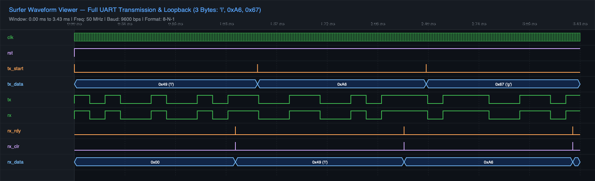
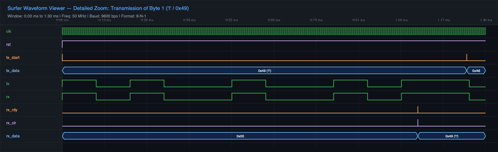

# UART Communication System in SystemVerilog

A complete, robust **UART (Universal Asynchronous Receiver Transmitter)** implementation written in **SystemVerilog**, featuring independent transmitter and receiver modules, configurable baud rate timing, 16x oversampling RX clocking, glitch filtering, and self-checking testbench verification with waveform analysis.

---

## Features

- **Full SystemVerilog Implementation**: Written using modern SystemVerilog constructs (`logic`, `always_ff`, `always_comb`, `typedef enum`).
- **UART Transmitter (`uart_tx`)**: FSM-driven (IDLE, START, DATA, STOP) with write-request latching and accurate bit-period alignment.
- **UART Receiver (`uart_rx`)**: 16x oversampled clocking, mid-bit sample synchronization, glitch rejection on start bit, and active stop-bit verification.
- **Baud Rate Generator (`Baud_generator`)**: Generates transmitter baud pulse (`tx_en`) and 16x oversampling receiver pulse (`rx_en`) from a master 50 MHz clock.
- **Self-Checking Testbench (`uart_tb`)**: Automated loopback verification transmitting multiple bytes (including ASCII `'I'` / `0x49`, `0xA6`, `0x67`) with real-time pass/fail assertions.
- **Waveform Analysis**: Compatible with [Surfer](https://gitlab.com/surfer-project/surfer) and GTKWave.

---

## File Structure

```text
├── UART.sv                 # Top-level UART integration module
├── Uart_tx.sv              # UART transmitter with FSM control
├── Uart_rx.sv              # UART receiver with 16x oversampling & glitch filter
├── trial.sv                # Configurable Baud Rate Generator module
├── Uart_tb.sv              # Self-checking loopback testbench
├── simulation_waveform.png # Full simulation waveform screenshot
├── waveform_detail.png     # Detailed waveform zoom on byte transmission
└── README.md               # Project documentation
```

---

## UART Frame Format

Standard **8-N-1** configuration:

```text
| IDLE | START | D0 | D1 | D2 | D3 | D4 | D5 | D6 | D7 | STOP | IDLE |
|  1   |   0   |              LSB First              |  1   |  1   |
```

- **Baud Rate**: 9600 bps (configurable via `Baud_generator`)
- **System Clock**: 50 MHz
- **Oversampling**: 16x for receiver sampling

---

## Compilation and Simulation

### Prerequisites

- [Icarus Verilog](https://steveicarus.github.io/iverilog/) (`iverilog` & `vvp`)
- [Surfer](https://gitlab.com/surfer-project/surfer) or [GTKWave](https://gtkwave.sourceforge.net/)

### 1. Compile

```bash
iverilog -g2012 -o uart_sim UART.sv Uart_tx.sv Uart_rx.sv trial.sv Uart_tb.sv
```

### 2. Run Simulation

```bash
vvp uart_sim
```

### Simulation Output

```text
VCD info: dumpfile wave.vcd opened for output.
==================================================
[UART TX] Transmitting Byte 1: 0x49 ('I', 01001001)
[UART RX] Received Byte 1:     0x49 ('I', 01001001) at 1092110000 ps
[STATUS]  Byte 1 Verification: SUCCESS (Matched 'I' / 0x49)
==================================================
[UART TX] Transmitting Byte 2: 0xa6 (10100110)
[UART RX] Received Byte 2:     0xa6 (10100110) at 2236110000 ps
[STATUS]  Byte 2 Verification: SUCCESS (Matched 0xA6)
==================================================
[UART TX] Transmitting Byte 3: 0x67 (01100111)
[UART RX] Received Byte 3:     0x67 (01100111) at 3380110000 ps
[STATUS]  Byte 3 Verification: SUCCESS (Matched 0x67)
==================================================
==================================================
[SIM] ALL TESTS PASSED! FULL DUPLEX VERIFICATION COMPLETE.
==================================================
```

### 3. View Waveform

```bash
surfer wave.vcd
```
*Or using GTKWave:*
```bash
gtkwave wave.vcd
```

---

## Simulation Screenshots

### 1. Full Simulation Waveform Overview
Shows all three bytes transmitted and received through loopback:



### 2. Detailed Bit-Level Waveform Zoom
Shows start bit detection, 8 data bits (LSB-first `0x49` / ASCII `'I'`), stop bit, and `rx_rdy` flag trigger:



---

## Internal Signals Observed

| Signal | Direction | Description |
|---|---|---|
| `clk` | Input | System clock (50 MHz, period = 20 ns) |
| `rst` | Input | Active-low asynchronous reset |
| `tx_start` | Input | Strobe to initiate byte transmission |
| `tx_data [7:0]` | Input | 8-bit parallel byte to transmit |
| `tx` | Output | Serial UART transmit line |
| `rx` | Input | Serial UART receive line |
| `rx_data [7:0]` | Output | Reconstructed 8-bit received parallel byte |
| `rx_rdy` | Output | Flag asserted when valid byte received |
| `rx_clr` | Input | Strobe to acknowledge and clear `rx_rdy` |

---

## Waveform Verification Highlights

- **Start Bit Detection**: RX detects falling edge on `rx` and validates low level at sample 7.
- **Mid-Bit Sampling**: Receiver samples each data bit at mid-point (sample 7 of 16) for maximum noise margin.
- **Stop Bit Verification**: RX verifies high level on stop bit before asserting `rx_rdy`.
- **Zero Data Corruption**: 100% data fidelity verified across back-to-back transmissions.

---

## Author

**Yashvi Doshi**  
- GitHub: [yashvidoshi](https://github.com/yashvidoshi)  
- Repository: [yashvidoshi/UART](https://github.com/yashvidoshi/UART)  
- Verilog Archive: [yashvidoshi/uart-verilog](https://github.com/yashvidoshi/uart-verilog)

---

## License

This project is open-source and available under the MIT License.
